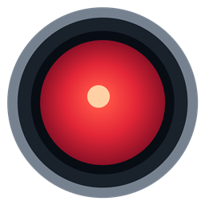
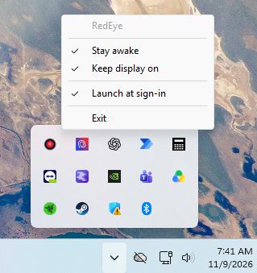

<p align="center">
  
</p>

# RedEye

Keep Windows awake while your work runs. RedEye is a small tray app that
prevents automatic idle sleep, with an option to keep the display on too.

## [Download RedEye for Windows](https://github.com/tbrownhe/RedEye/releases)

**Windows 10/11 | x64 | Portable**

On the release page, expand **Assets** and choose **RedEye.exe** or
**RedEye-windows-x64.zip**. The ZIP includes the app and usage instructions.
`SHA256SUMS.txt` is available to verify your download. Releases marked
**Pre-release** are test versions. The **Source code** archives are for
building the app yourself.

## Get started

1. Download the executable, or extract it from the ZIP.
2. Save `RedEye.exe` to a folder you will keep, such as
   `%LOCALAPPDATA%\RedEye`, and double-click it. No installer, administrator
   access, Rust, or extra icon files are required.
3. Find the red eye in the Windows notification area. It may be inside the
   hidden-icons menu opened with the **^** arrow.

RedEye starts awake. By default, the display can still turn off; a saved
**Keep display on** preference is restored on later launches. There is no
main window or console to keep open.

## See it in action



*RedEye's tray menu, shown with Stay awake, Keep display on, and Launch at
sign-in enabled. Sign-in launch is off until you choose to enable it.*

## Use RedEye

**Left-click** the eye to toggle awake mode. **Right-click** it to open the menu:

| Menu item | What it does |
|---|---|
| **Stay awake** | Prevent automatic idle sleep while checked. |
| **Keep display on** | Also keep the screen on while awake. The preference is remembered, including while sleep is allowed. |
| **Launch at sign-in** | Start RedEye automatically when you sign in; optional and off by default. |
| **Exit** | Clear RedEye's power request, remove its icon, and close the app. |

The eye, tooltip, and menu checkmarks show the current state. Hover over the
icon for **Awake** or **Sleep allowed**. Each launch starts awake; opening a
second copy leaves the existing copy running.

| Awake | Sleep allowed |
|:---:|:---:|
|  |  |

Original eye artwork used by RedEye. See [icon details and actual tray sizes](docs/ICONS.md).

## Launch at sign-in

Run RedEye from its permanent folder, then enable **Launch at sign-in** in the
tray menu. RedEye starts awake when you sign in. Windows startup controls and
organizational policy can still disable or delay startup.

If you move the app, turn sign-in launch off and enable it again from the new
copy. RedEye refuses startup registration from known Cargo build or temporary
folders. A checked menu item means a RedEye startup entry exists, including
an entry pointing to an older copy.

## Remove RedEye

Turn off **Launch at sign-in**, choose **Exit**, then delete `RedEye.exe` and
any extracted package files. No service or scheduled task is installed.
Optional saved-preference cleanup is described under [settings storage](#settings-storage).

## Compatibility and limits

- Intended for Windows 10/11 x64. Core behavior has been checked on Windows 11;
  Windows 10 and additional manual checks remain unverified. See
  [validation evidence and remaining checks](docs/VALIDATION.md).
- RedEye allows locking, explicit sleep/shutdown, and organizational policies
  to work normally. Remote-session inactivity behavior is unaffected.
- The icon uses display scaling at launch. Restart RedEye after changing
  scaling for the sharpest icon; multiple DPI settings remain unverified.
- Use **Exit** for normal cleanup. Forced termination relies on Windows
  releasing the request; a stale tray icon may remain briefly.

## For developers

### Product scope

RedEye supports long-running computational work, including autonomous coding
sessions, through native Windows power requests instead of periodic NumLock
input simulation. Keep the utility compact, dependable, low in CPU/memory
use, and understandable to an engineer learning Rust. Correctness and
readability take priority over feature count.

The v0.1 product is a native notification-area utility with no visible main
window, service, elevation, embedded browser, telemetry, runtime networking,
or automatic updates. Keep-awake behavior must not poll or simulate input.
Respect locking, explicit sleep/shutdown, organizational policies, and remote
session inactivity. Avoid large UI frameworks such as Tauri, Electron, and
PySide, unnecessary async runtimes, and databases.

Out of scope for v0.1: timed or scheduled awake sessions, global hotkeys,
automatic process/task detection, desktop widgets or floating overlays, a
full settings window, integrations (including Codex-specific integration),
remote control, and cloud synchronization.

Deliver a working Rust project, portable Windows executable with embedded
original active/inactive icons, reproducible build instructions, usage and
removal documentation, and concise explanations of the relevant Rust and
Windows decisions. [Icon direction](docs/ICONS.md),
[milestone gates](docs/WORKFLOW.md), and [test evidence](docs/VALIDATION.md)
complete the product baseline.

### Build from source

Use stable Rust with the native Windows x64 MSVC toolchain, C++ build tools,
and Windows SDK resource compiler (`rc.exe`).
Rust/Cargo 1.99.1 was verified for this project:

```powershell
cargo build --release --locked
& .\target\release\redeye.exe
```

The checked-in target configuration links the CRT statically, avoiding a
separate Visual C++ runtime installation. Copy the executable to a stable
folder before enabling sign-in launch. For console diagnostics during
development, use `cargo build --locked` and `target\debug\redeye.exe`.

### Check

```powershell
cargo fmt --check
cargo check --locked
cargo clippy --locked --all-targets -- -D warnings
cargo test --locked
```

### Contributing and CI

Fork the repository or work on a feature branch, then open a pull request to
`main`. Contributions require a passing **Windows CI** check and approval from
`@tbrownhe`, the code owner for every path. New commits dismiss stale approvals,
and review conversations must be resolved. Direct changes, force pushes, and
deletion of `main` are blocked. The owner can bypass the review requirement
through a PR; the PR and CI requirements still apply to the owner.

GitHub automatically deletes eligible source branches in this repository after
merge. `main` remains protected against deletion. Source branches in forks
depend on the fork's own cleanup setting and the merger's write access there.
The intended cleanup setting is recorded in
[repository settings](.github/repository-settings.json).

[CI](.github/workflows/ci.yml) runs on PRs to `main`, pushes to `main`, and
manual dispatch. It uses Windows Server 2025 with Visual Studio 2026 and pinned
Rust 1.99.1 to check formatting, compilation, Clippy, tests, and the release
build. Each successful run provides a `RedEye-windows-x64` artifact containing
the executable, portable ZIP, and SHA-256 checksums, retained for seven days.
These are CI builds, not automatically published releases.

GitHub may require maintainer approval before running a first-time external
contributor's workflow. That approval is separate from approval to merge the
PR. Fork builds use read-only permissions and no repository secrets. CI does
not replace the native tray, power-request, sign-in, and OS coverage checks in
[the validation evidence](docs/VALIDATION.md).

### Releases

The owner creates a version tag, such as `v0.1.0-rc.1`, on an approved commit
already merged to `main`. The tag must exactly match the version in
`Cargo.toml`. Version tags are restricted to `@tbrownhe`; the main-branch PR
and CI requirements still apply before tagging.

[The release workflow](.github/workflows/release.yml) requires successful
main-push CI for that exact commit, rebuilds on Windows, and creates an
unpublished draft with three downloads: `RedEye.exe`, `RedEye-windows-x64.zip`,
and `SHA256SUMS.txt`. The ZIP contains the executable, a versioned usage README,
and internal checksums. A version containing a prerelease suffix, such as
`-rc.1`, is marked as a prerelease. The owner checks the draft and manually
publishes it; published releases appear on the repository's Releases page.

A manual run of **Draft release** from `main` previews the same package as a
seven-day Actions artifact. It creates neither a tag nor a release. See
[the release procedure](docs/WORKFLOW.md#versioned-draft-releases) for version
bumps, checks, and recovery from an incomplete draft. Native checks that remain
unperformed are listed in [validation evidence](docs/VALIDATION.md).

### Code layout

| File | Responsibility |
|---|---|
| `src/main.rs` | Initialization, effective state and display preference, main-thread event coordination, and graceful shutdown |
| `src/power.rs` | Small safe `PowerRequest` interface around thread-owned `SetThreadExecutionState`; independent of UI code |
| `src/tray.rs` | Hidden native window, blocking event dispatch, icon/menu/tooltip updates, and owned UI resources |
| `src/settings.rs` | Per-user display preference and actual opt-in startup registration |
| `src/instance.rs` | Session/user single-instance guard |
| `build.rs` | Build-time executable icon resource embedding |

Keep ownership, borrowing, unsafe FFI boundaries, native event-loop behavior,
and explicit cleanup explanations tied to the code being changed. Avoid
abstractions or modules without a current consumer. Single-instance protection
must stay lightweight; do not introduce IPC or a service merely to enforce it.

`windows-sys` 0.61.2 supplies native tray bindings, with `windows-link` as its
only supporting crate. `power.rs` wraps one scalar Kernel32 call. Its owner
stays on the main thread alongside the blocking native event loop. State
changes are committed only after Windows accepts them. Normal shutdown
explicitly handles cleanup errors; destructors provide fallback handle
cleanup. Tests cover the flag matrix, failed transitions, and icon bounds;
external Windows observations are also required. Icons are embedded, with
[reproducible drawing source](docs/ICONS.md).

The build also uses `winresource` 0.1.34 with default features disabled and
`version_check` to embed the active eye as the executable's Explorer/shortcut
icon. These are build-only dependencies; both tray states remain embedded.

### Settings storage

Only `HKCU\Software\Microsoft\Windows\CurrentVersion\Run`'s `RedEye` value is
changed for startup. The menu rereads the actual registration whenever opened.
The executable path is quoted and must fit Windows Run's 260-character command
limit. No machine-wide startup setting is changed.

The display preference is DWORD `KeepDisplayOn` under `HKCU\Software\RedEye`.
Missing data defaults off; malformed data produces a warning and defaults off
for that launch. A failed save reports that the current preference applies
only to the current run. No active-state preference is stored. After removing
RedEye, optionally remove only the `KeepDisplayOn` value from this settings key.

RedEye runs without elevation. Windows may require an Administrator terminal
for the separate `powercfg /requests` diagnostic.
