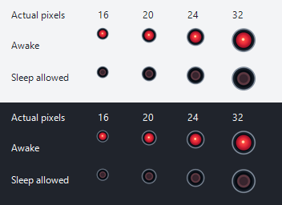

# RedEye tray icons

The two icons are original geometric artwork. `icon_idea.jpg` was inspected
only as a mood reference: the new drawing uses a simpler graphite housing,
cool grey rim, and red optical center, without copying its reflections or
film artwork. There is no text, animation, or intricate ornamentation.

- [Awake icon](../assets/redeye-active.ico): a broad red lens, radial light,
  and a small warm luminous core. The core and larger bright area make its
  state distinguishable by lightness and shape as well as hue.
- [Sleep allowed icon](../assets/redeye-inactive.ico): a smaller matte,
  desaturated burgundy lens and dark center, with no luminous core or glow.
- [Actual-size preview](../assets/tray-preview.png): both states at 16, 20,
  24, and 32 pixels against light and dark backgrounds. View at 100% zoom.



Both ICO files contain eight 32-bit RGBA PNG frames: 16, 20, 24, 32, 48,
64, 128, and 256 pixels square. Transparent corners preserve the circular
silhouette. Each size is drawn separately with 4x supersampling, rather than
resizing one small tray bitmap. PNG-compressed ICO frames are intended for
the supported Windows 10/11 platforms.

## Regenerate

The source is [tools/generate-icons.ps1](../tools/generate-icons.ps1), a
development-only Windows PowerShell/System.Drawing script. No additional
packages or runtime dependencies are required:

```powershell
powershell -NoProfile -ExecutionPolicy Bypass -File .\tools\generate-icons.ps1
```

The process-scoped execution-policy argument does not change the machine's
policy. The script rewrites only the two ICO files and preview under `assets`.

## Native integration

Embed the ICO files in the executable. Select an embedded frame near the
Windows small-icon metric, bounds-check its directory entry, and decode it
with `CreateIconFromResourceEx`. Release the resulting owned `HICON` with
`DestroyIcon` once it is no longer used. The preview is documentation, not a
runtime asset. Milestone 2 uses the active icon; milestone 3 integrates both.
The active ICO is also embedded as the executable's native application icon
resource, so Explorer and shortcuts can select its full set of sizes. This
build-time resource is separate from the tray's two runtime visual states.

State must also remain textual: `RedEye — Awake` / `RedEye — Sleep allowed`
tooltips and the `Stay awake` menu checkmark. Left-click toggles; right-click
opens the native menu without toggling. A failed power transition retains the
last successful state. Present failures with an actionable native message
when there is no console.

The designer inspected the rendered contact sheet at actual 16/20/24/32 pixel
sizes on both backgrounds. The active core and inactive dark center remain
distinct at 16 pixels. This is asset inspection, not an in-context Windows
tray/DPI test. Native tray readability, scaling, and high-DPI monitor changes
remain for release validation.
